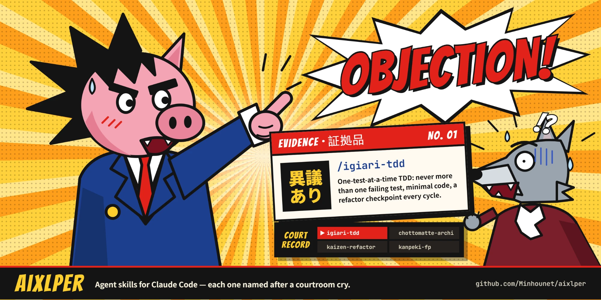

# aixlper



Reusable AI agent **skills**, written once and used in both
[Claude Code](https://code.claude.com) and [Gemini CLI](https://github.com/google-gemini/gemini-cli).
Each skill is a `SKILL.md` under `skills/<name>/`, following the open
[Agent Skills](https://code.claude.com/docs/en/skills.md) standard.

## Skills

| Skill | What it does |
|---|---|
| [`igiari-tdd`](skills/igiari-tdd/SKILL.md) | Strict one-test-at-a-time TDD for Java, with a refactor step every cycle. |
| [`kanpeki-fp`](skills/kanpeki-fp/SKILL.md) | Functional style for Java with Vavr: pure guards, Either/Option, named pipelines. |
| [`chottomatte-archi`](skills/chottomatte-archi/SKILL.md) | Dependency inversion for Java: use cases depend only on interfaces. |
| [`kaizen-refactor`](skills/kaizen-refactor/SKILL.md) | Safe refactoring of existing Java code, driven by IDE inspection findings. |
| [`yusaburi-mutation`](skills/yusaburi-mutation/SKILL.md) | PIT mutation testing: checks that tests catch a change, not just run the code. |
| [`tantei-debug`](skills/tantei-debug/SKILL.md) | Finds where a Java bug is by bisection with a debugger, with a resumable note. |
| [`tonosaman-deploy`](skills/tonosaman-deploy/SKILL.md) | Builds a Java app and runs it in a local Docker or Podman container. |
| [`shoko-playwright`](skills/shoko-playwright/SKILL.md) | Validates a web UI change against its acceptance criteria with Playwright. |
| [`objection-conception`](skills/objection-conception/SKILL.md) | Keeps a ticket's design and acceptance criteria on disk, and traces them to the code. |
| [`mujitsu-documentum`](skills/mujitsu-documentum/SKILL.md) | Idempotent bash scripts for Documentum DQL/API work. *Unverified: not yet run on a real docbase.* |
| [`kurae-bash`](skills/kurae-bash/SKILL.md) | Hardening patterns for interactive bash CLI tools. |
| [`saiban-orchestrator`](skills/saiban-orchestrator/SKILL.md) | **Claude Code only.** Runs a known development process end to end, stopping only at real decisions. |

## Install

### Claude Code

```bash
curl -fsSL https://raw.githubusercontent.com/Minhounet/aixlper/main/scripts/install.sh | bash
```

Copies every skill into `~/.claude/skills/`. Run it again to update. Use
`AIXLPER_TARGET=.claude/skills` to install into one project instead.

### Gemini CLI

```bash
gemini extensions install https://github.com/Minhounet/aixlper --auto-update
```

This also installs three helper agents (`kenji-reviewer`, `shonin-dev`,
`tantei-inspector`; list them with `/agents`). The orchestrator stays Claude Code only.

> Not yet checked against a live Gemini CLI install. If it fails, please open an issue.

## Quick start

1. Install for the client you use (above).
2. Start a session in a Java project and describe a small change:
   - Claude Code: `/igiari-tdd add a method that sums a list of ints`
   - Gemini CLI: describe the same task; Gemini proposes the matching skill from its description and asks you to confirm.
3. Watch it go one failing test at a time. That is the skill working.

When a process is known and you want it run for you, use the orchestrator:
[`docs/tutorial-saiban.md`](docs/tutorial-saiban.md) ([Français](docs/tutorial-saiban.fr.md)).

## More

- [`CONTRIBUTING.md`](CONTRIBUTING.md): testing, repo layout, Gemini agents, and the author's global config.
- [`CLAUDE.md`](CLAUDE.md): design rules and the working agreement for maintaining both clients.
