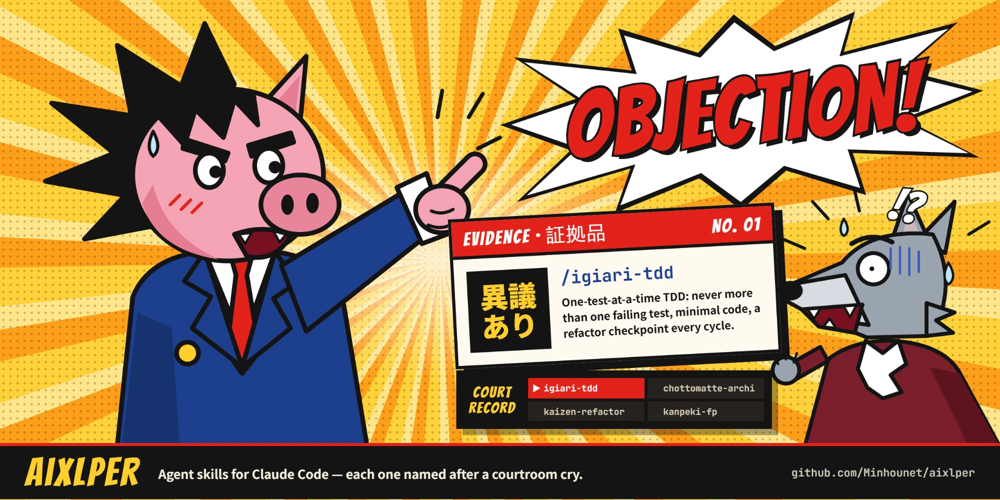

# aixlper



A repository of generic, reusable AI agent **skills** — written once, usable
in multiple AI coding assistants (primarily [Claude Code](https://code.claude.com)
and [Gemini CLI](https://github.com/google-gemini/gemini-cli)).

Skills follow the open **[Agent Skills](https://code.claude.com/docs/en/skills.md)**
standard: a `SKILL.md` file with `name`/`description` YAML frontmatter, plus
optional bundled scripts/references. Both clients read this format natively,
so each skill is written once under `skills/<name>/` and works in either
tool — no per-client fork.

## Available skills

| Skill | What it does |
|---|---|
| [`igiari-tdd`](skills/igiari-tdd/SKILL.md) | One-test-at-a-time TDD for Java: never more than one failing test at a time, minimal implementation only, a mandatory refactor checkpoint every cycle. |
| [`chottomatte-archi`](skills/chottomatte-archi/SKILL.md) | Dependency inversion via interfaces and constructor injection for Java: the use case as entry point, depending only on repository/service interfaces. |
| [`kurae-bash`](skills/kurae-bash/SKILL.md) | Seven hardening patterns for robust, interactive bash CLI tools: `bind -x` keybinding dispatch, annotation-driven command registries, double-load guards, framework-free testing, and more. |
| [`mujitsu-documentum`](skills/mujitsu-documentum/SKILL.md) | Idempotent bash scripts composing Documentum DQL + API calls: existence-check-before-create, output-based error detection, safe session lifecycle. |
| [`objection-conception`](skills/objection-conception/SKILL.md) | Persists a ticket's design conversation and the difficulties hit along the way to disk, so the thinking survives past the current session; checks, traces and proves its acceptance criteria before the ticket can close. |
| [`tonosaman-deploy`](skills/tonosaman-deploy/SKILL.md) | Builds a Java project and runs the fresh artifact in a local Docker or Podman container — plain JDK batch, Spring Boot, or Nuxeo — swapping the artifact in by bind mount instead of rebuilding the image each time. |

## Installing

### Claude Code — one-line install (works today)

```bash
curl -fsSL https://raw.githubusercontent.com/Minhounet/aixlper/main/scripts/install.sh | bash
```

This copies every skill into `~/.claude/skills/` — no manifest, no
marketplace, nothing to publish first. Re-run the same command any time to
update to the latest version. To install into a single project instead of
personally, or to pin a branch/tag:

```bash
curl -fsSL https://raw.githubusercontent.com/Minhounet/aixlper/main/scripts/install.sh | AIXLPER_TARGET=.claude/skills bash
curl -fsSL https://raw.githubusercontent.com/Minhounet/aixlper/main/scripts/install.sh | AIXLPER_REF=some-branch bash
```

Claude Code picks these up on the next session; each skill is invoked as
`/igiari-tdd` or `/chottomatte-archi`, or triggers
automatically based on its `description`.

### Gemini CLI — one-line install

```bash
gemini extensions install https://github.com/Minhounet/aixlper --auto-update
```

This requires `git` on your machine (Gemini CLI's own requirement for
installing from GitHub) but no manual clone step — Gemini CLI clones it
internally. `--auto-update` keeps it in sync with the repo.

> This repo's [`gemini-extension.json`](gemini-extension.json) manifest
> hasn't been verified against a live Gemini CLI install yet (see
> [`CLAUDE.md`](CLAUDE.md) — no automated Gemini check runs here). If this
> command doesn't work as expected, please open an issue.

### Global config (personal machines)

The skills above are for anyone. This part is the repo author's own machine
setup — global `CLAUDE.md` (plus the `java.md` / `nuxeo.md` it imports), the
`litellm-budget.py` script that backs the statusline/session-start budget
display, and a generated `settings.json` wiring both in:

```bash
./scripts/install-global.sh            # from a clone
curl -fsSL https://raw.githubusercontent.com/Minhounet/aixlper/main/scripts/install-global.sh | bash
```

It is deliberately **separate** from `install.sh` — a skills installer should
never rewrite a stranger's `CLAUDE.md` or `settings.json`. It also never touches
`~/.claude/skills/`, so a development machine where those are symlinks back into
a clone keeps working.

**No secret is stored in this repo.** `global/settings.template.json` carries a
`@@ENV_BLOCK@@` marker; the API gateway, token and proxy are read at install
time from `~/.claude/aixlper.env` (gitignored) or the shell environment:

```bash
cp global/aixlper.env.example ~/.claude/aixlper.env
chmod 600 ~/.claude/aixlper.env   # then fill it in
./scripts/install-global.sh
```

Leave every value empty and the env block collapses to telemetry alone, which
is what a personal machine with no corporate gateway wants. Existing files are
backed up to `.bak.<epoch>` before being replaced, re-running changes nothing if
nothing differs, and `--dry-run` reports without writing.

`settings.template.json` also pins `model` to `opus[1m]`. Re-running the
installer restores that value, so a temporary model override made outside this
repo (by hand, or by the client itself) does not survive a re-install — edit
the template if you want a different default to stick.

### Marketplace distribution (optional, not set up)

Claude Code also supports a plugin-marketplace mechanism
(`.claude-plugin/marketplace.json` + `plugin.json`, installed with
`/plugin marketplace add minhounet/aixlper`). It isn't set up in this
repo — the curl install above already covers "install easily" without
that extra machinery, which mainly pays off if this ever needs versioned
releases or install/update/uninstall commands for a wider audience.

## Tutorial: the `iterate` agent

*Version française plus bas : [Tutoriel](#tutoriel--lagent-iterate).*

`iterate` is a **Claude Code agent** (not portable to Gemini CLI) that runs
the skills above for you, in the right order, and stops only when a decision
is really yours. It keeps a written trail of every decision, so you can follow
the work from anywhere, your phone included.

### 1. Install

```bash
./scripts/install-global.sh   # copies global/agents/*.md to ~/.claude/agents/
./scripts/install.sh          # the skills themselves
```

To install only the agents: `cp global/agents/*.md ~/.claude/agents/`.
Nothing changes in your projects until you ask for the agent.

### 2. Start it

```bash
claude --agent iterate
```

It only applies to that session: plain `claude` stays the normal assistant
for everything else (questions, quick edits). Tip: `alias ci='claude --agent
iterate --permission-mode acceptEdits'` lets it edit files without asking
each time (commands and pushes still ask). The mode has to be on the command
line: `permissionMode` in the agent file is ignored when the agent is the
main session (checked). Avoid `"agent": "iterate"` in a settings file unless you want
every session there to start as `iterate`, since it replaces the default
system prompt.

Then describe the work in your first message. Two examples:

- **Fix mode** (a clear change to existing code):
  *"Bug: an account created as `alice` cannot log in as `Alice`. Usernames
  must be case-insensitive."*
  It uses `igiari-tdd` + `kanpeki-fp` (+ `kaizen-refactor`), nothing else.
- **Build mode** (something new):
  *"Ticket PROJ-8: lock an account after three failed logins. AC1: ...
  AC2: ..."* It uses `chottomatte-archi` first, then `objection-conception`
  for the ticket and its acceptance criteria (ACs), then TDD.

It proposes the mode; you confirm. Options you can add to that first
message:

| Say | Effect |
|---|---|
| `pre-approve TDD plans` | No approval per AC plan. |
| `no pauses` | No stop after each AC. |
| `no review` | No `iterate-reviewer` after each AC (build mode). |
| `with review` | In fix mode, an `iterate-reviewer` pass on the fix (off by default; about $0.30). |
| `with dev` | GREEN steps go to `iterate-dev`, which only sees the failing test (off by default). |

### 3. What happens

1. **One approval up front** (build mode): the structural plan, the AC check
   and any contradiction in the ticket, quoted on both sides.
2. **One TDD run per AC**, true TDD rather than test-first: one test at a
   time, seen failing, then the least code that passes it, then a refactor;
   never a batch of tests written ahead. The run ends with the full build
   and an audit of the git history that proves each test was red first.
3. **A review per AC** by `iterate-reviewer`, which can read but never edit:
   is the AC really proven, does the structure hold, nothing extra?
4. **The AC record is updated** in `docs/ticket/<id>/acceptance.md`, then
   committed.
5. **A pause**: *"AC1 done. Continue, or /clear and resume?"*

It asks you only for hard-to-reverse actions, real forks, deviations from
an approved plan, out-of-scope work, or an unclear AC. Everything else, it
decides and writes down.

### 4. Follow it and save money

- `docs/decisions/<topic>.md`: every decision, why, and what was rejected.
  Its `Resume` block always says where the work stands.
- `docs/ticket/<id>/`: design, ACs with their evidence, difficulties met.
- Context gets expensive as it grows. At a pause, type `/clear`, then
  `claude --agent iterate` and *"resume PROJ-8"*: it continues from the
  `Resume` block instead of re-reading everything.

It commits locally, never pushes, and never writes to Jira unless asked.

**Cost, measured** on a two-AC ticket: about $2.60 on Sonnet, $6.30 on
Opus; `with dev` adds about half (about $4 on Sonnet). A small fix-mode bug:
about $0.30.

### 5. Improve it

The final report always ends with **Improvements**: friction it hit and the
exact wording it would change, in the agent or a skill. It never applies
them itself. Edit `global/agents/iterate.md` (or the skill) and reinstall,
or symlink `~/.claude/agents/iterate.md` to the repo file so edits apply at
once.

## Tutoriel : l'agent `iterate`

`iterate` est un **agent Claude Code** (pas portable sur Gemini CLI) qui
enchaîne les skills ci-dessus à ta place, dans le bon ordre, et ne s'arrête
que quand une décision t'appartient vraiment. Il garde une trace écrite de
chaque décision : tu peux suivre le travail de partout, y compris depuis ton
téléphone.

### 1. Installer

```bash
./scripts/install-global.sh   # copie global/agents/*.md dans ~/.claude/agents/
./scripts/install.sh          # les skills eux-mêmes
```

Pour n'installer que les agents : `cp global/agents/*.md ~/.claude/agents/`.
Rien ne change dans tes projets tant que tu ne demandes pas l'agent.

### 2. Le lancer

```bash
claude --agent iterate
```

Ça ne vaut que pour cette session : `claude` tout court reste l'assistant
normal pour le reste (questions, petites modifs). Astuce : `alias
ci='claude --agent iterate --permission-mode acceptEdits'` le laisse
modifier les fichiers sans demander à chaque fois (les commandes et les push
demandent toujours). Le mode doit être sur la ligne de commande :
`permissionMode` dans le fichier de l'agent est ignoré quand l'agent est la
session principale (vérifié). Évite `"agent": "iterate"` dans un fichier de
settings, sauf si tu veux que chaque session y démarre en `iterate`, car il
remplace le prompt système par défaut.

Puis décris le travail dans ton premier message. Deux exemples :

- **Mode fix** (un changement clair sur du code existant) :
  *« Bug : un compte créé en `alice` ne peut pas se connecter en `Alice`.
  Les identifiants doivent être insensibles à la casse. »*
  Il utilise `igiari-tdd` + `kanpeki-fp` (+ `kaizen-refactor`), rien d'autre.
- **Mode build** (quelque chose de nouveau) :
  *« Ticket PROJ-8 : bloquer un compte après trois échecs de connexion.
  CA1 : ... CA2 : ... »* Il passe d'abord par `chottomatte-archi`, puis
  `objection-conception` pour le ticket et ses critères d'acceptation (CA),
  puis le TDD.

Il propose le mode, tu confirmes. Options à ajouter dans ce premier
message :

| Dire | Effet |
|---|---|
| `pre-approve TDD plans` | Pas d'approbation par plan de CA. |
| `no pauses` | Pas d'arrêt après chaque CA. |
| `no review` | Pas d'`iterate-reviewer` après chaque CA (mode build). |
| `with review` | En mode fix, une revue `iterate-reviewer` du correctif (désactivée par défaut ; environ 0,30 $). |
| `with dev` | Les étapes GREEN passent à `iterate-dev`, qui ne voit que le test en échec (désactivé par défaut). |

### 3. Ce qui se passe

1. **Une seule approbation au départ** (mode build) : le plan de structure,
   la vérification des CA et toute contradiction du ticket, citée des deux
   côtés.
2. **Un cycle TDD par CA**, du vrai TDD et pas du « test first » : un test
   à la fois, vu en échec, puis le minimum de code qui le fait passer, puis
   un refactoring ; jamais une série de tests écrits à l'avance. Le cycle se
   termine par le build complet et un audit de l'historique git qui prouve
   que chaque test a d'abord été rouge.
3. **Une revue par CA** par `iterate-reviewer`, qui lit mais ne modifie
   jamais : la CA est-elle vraiment prouvée, la structure tient-elle, rien
   de plus que demandé ?
4. **Le suivi de la CA est mis à jour** dans
   `docs/ticket/<id>/acceptance.md`, puis commité.
5. **Une pause** : *« AC1 done. Continue, or /clear and resume? »*

Il ne te demande ton avis que pour une action difficile à annuler, un vrai
choix, un écart par rapport à un plan approuvé, du hors-périmètre ou une CA
floue. Le reste, il le décide et l'écrit.

### 4. Le suivre et économiser

- `docs/decisions/<sujet>.md` : chaque décision, pourquoi, et ce qui a été
  écarté. Son bloc `Resume` dit toujours où en est le travail.
- `docs/ticket/<id>/` : conception, CA avec leurs preuves, difficultés
  rencontrées.
- Le contexte coûte de plus en plus cher en grossissant. À une pause, tape
  `/clear`, puis `claude --agent iterate` et *« resume PROJ-8 »* : il
  reprend depuis le bloc `Resume` au lieu de tout relire.

Il commite en local, ne pousse jamais, et n'écrit jamais dans Jira sans
qu'on le lui demande.

**Coût mesuré** sur un ticket à deux CA : environ 2,60 $ avec Sonnet,
6,30 $ avec Opus ; `with dev` ajoute environ la moitié (environ 4 $ avec
Sonnet). Un petit bug en mode fix : environ 0,30 $.

### 5. L'améliorer

Le rapport final se termine toujours par **Improvements** : les frictions
rencontrées et la formulation exacte qu'il changerait, dans l'agent ou un
skill. Il ne les applique jamais lui-même. Modifie
`global/agents/iterate.md` (ou le skill) et réinstalle, ou crée un lien
symbolique de `~/.claude/agents/iterate.md` vers le fichier du repo pour que
les modifications s'appliquent tout de suite.

## Repo layout

```
skills/<skill-name>/SKILL.md      # one skill per directory
skills/<skill-name>/references/   # optional supporting files
skills/<skill-name>/scripts/      # optional scripts the skill runs
skills/<skill-name>/evals/        # claude plugin eval cases for the skill

global/                           # author's global ~/.claude config
global/litellm-budget.py          # statusline + SessionStart-hook budget script
global/settings.template.json     # public-safe; secrets injected at install
global/agents/                    # iterate, iterate-reviewer, iterate-dev (Claude Code only)
```

## Contributing / testing

- `make validate` — checks every skill's `SKILL.md` frontmatter is
  well-formed and limited to the portable subset both clients support.
- `make eval` — runs `claude plugin eval` for any skill with an `evals/`
  directory (behavioral testing; costs API usage, run locally/manually).
- `make ci` — both, in that order. `make validate` alone is wired into
  CI (`.github/workflows/ci.yml`) and is free to run on every push/PR.

See [`CLAUDE.md`](CLAUDE.md) for the full design rationale and in-progress
notes on each skill.
